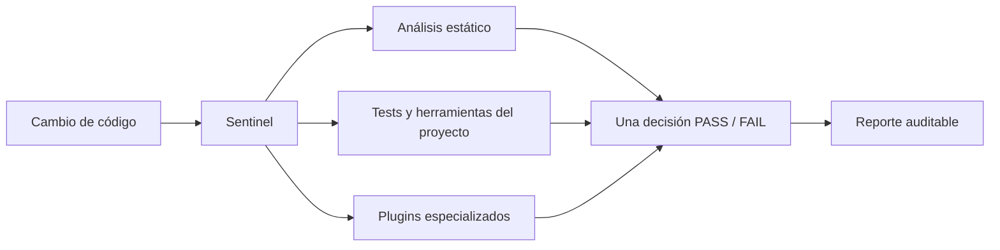

# Glory Sentinel


**Una sola forma de saber si un cambio está realmente listo.**

Glory Sentinel es una plataforma local de calidad para equipos que trabajan con desarrolladores, agentes de código o ambos. Analiza el código, reúne los checks del proyecto y produce una decisión de cierre reproducible: qué pasó, qué falló y qué debe corregirse antes de integrar.

No reemplaza tus tests, tu linter ni tu type-checker. Los convierte en partes de un mismo contrato para evitar que cada proyecto —o cada agente— termine inventando su propio gate, sus propios scripts y una definición diferente de “terminado”.

Sentinel es estático y determinista. Funciona localmente, no requiere IA, conexión a Internet, claves ni un servicio externo para analizar tu código.

## El problema que resuelve

En un proyecto real, la calidad suele estar repartida entre ESLint, tests, compiladores, scripts del repositorio, convenciones escritas y revisiones manuales. Cuando participan varios agentes, esa dispersión se vuelve más peligrosa: un check puede omitirse, duplicarse o producir un resultado que nadie conserva.

Sentinel concentra ese recorrido:



El resultado no es solo un exit code. Sentinel diferencia hallazgos del código, tests fallidos, timeouts, cancelaciones, errores de herramienta y cobertura que no llegó a ejecutarse. Un error operativo nunca se disfraza de PASS.

## Qué aporta

- **Problemas antes de producción.** Detecta patrones inseguros, errores de arquitectura y deuda técnica mientras todavía son baratos de corregir.
- **Una decisión coherente.** El mismo contrato decide si el cambio puede cerrarse, sin gates paralelos.
- **Evidencia útil.** Genera reportes Markdown y JSON que pueden leer personas, CI y agentes.
- **Reglas consistentes.** CLI, LSP y extensión de VS Code consumen el mismo motor de análisis.
- **Integración con tu stack.** Puede orquestar tests, linters, compiladores y analizadores externos como etapas declaradas, sin reimplementarlos.
- **Trabajo paralelo más seguro.** Su coordinación opcional aísla tareas en worktrees y conserva ownership, estado, integración y cleanup.

## Qué analiza

El catálogo cubre PHP/WordPress, TypeScript/React, JavaScript, CSS y Rust; cada regla, con su severidad y si viene activa, está en [rules.md](rules.md), generado desde el registro.
Entre otras cosas, Sentinel puede detectar:

- secretos hardcodeados, `eval`, procesos shell inseguros y SQL sin preparación;
- catches vacíos, errores enmascarados y recursos sin cleanup;
- componentes demasiado grandes, responsabilidades mezcladas y límites de arquitectura rotos;
- efectos React sin limpieza, mutaciones de estado y patrones frágiles de Zustand;
- contratos incompatibles entre APIs PHP y consumidores TypeScript;
- `unwrap`, `panic`, handlers acoplados a base de datos y otros riesgos habituales en Rust;
- convenciones específicas de un producto mediante reglas o adapters declarados y con ownership explícito.

Las reglas pueden activarse, desactivarse o cambiar de severidad por proyecto. El objetivo no es imponer un estilo universal, sino convertir las decisiones de calidad del equipo en controles repetibles.

Consulta el [catálogo completo de reglas](rules.md).

## Dos formas de usar Sentinel

### 1. Analizador estático

Es la entrada más sencilla. Puedes analizar un archivo o un repositorio y obtener resultados en Markdown o JSON:

```bash
sentinel analyze --workspace . --format markdown
sentinel analyze --file src/app.ts --format json
```

Códigos de salida de `analyze`: `0` si no hay hallazgos `error` (los `warning` no bloquean), `1` si hay al menos uno de severidad `error` y `2` por error de uso o de ejecución (por ejemplo, un archivo inexistente o una opción desconocida).

Este modo es útil en cualquier carpeta y no necesita coordinación de tareas ni un gate completo.

### 2. Quality gate

Cuando el proyecto necesita una decisión de cierre, `sentinel check` ejecuta las etapas declaradas y crea el reporte combinado:

```bash
sentinel check FEATURE-123 --stages sentinel-stages.json
```

El manifest indica qué herramientas forman parte del gate. Por ejemplo, este manifest ejecuta el propio analizador de Sentinel como una etapa estructurada:

```json
{
    "schemaVersion": 1,
    "stages": [
        {
            "name": "sentinel",
            "executable": "sentinel",
            "args": ["analyze", "--workspace", ".", "--format", "json", "--output", "{reportPath}"],
            "expectedSchemaVersion": "1",
            "timeoutMs": 60000
        }
    ]
}
```

Después puedes añadir ESLint, tests, compilación, VarSense u otra herramienta que emita el contrato estructurado. Sentinel conserva una sola decisión final y un solo lugar para consultar la evidencia.

Reglas del manifest: `reportPath` se resuelve dentro de `reportRoot` y `cwd` dentro del workspace; una etapa debe salir con código 0 y dejar un reporte válido (si sale distinto de 0 es `tool-error`, aunque exista el JSON). Contrato completo y claves admitidas: [docs/stage-manifest-contract.md](docs/stage-manifest-contract.md).

## Sentinel, gate y wrappers: la diferencia

- **Sentinel** es el producto: motor de reglas, CLI, reportes, orquestación y coordinación opcional.
- **El gate** es la operación `sentinel check <task-id>` que produce la decisión final.
- **`gate:check`** es solo un nombre de alias npm: `init --with-alias gate:check` lo crea apuntando a `sentinel check`. No decide nada por sí mismo.
- **Un analyzer o plugin** aporta hallazgos; no crea una segunda decisión de cierre.

En otras palabras: Sentinel contiene el gate. No son dos productos separados.

Los consumidores antiguos pueden conservar temporalmente `task:check` o `scripts/quality`, pero no deben añadirles lógica nueva. Sentinel incluye un inventario de migración para retirar esas copias sin perder cobertura.

## Requisitos

- Node.js 20 o superior (`engines.node` y CI usan 20). En servidores, el `node` por defecto puede ser más antiguo: comprueba `node --version` en la misma terminal donde ejecutarás `npm ci` y `npm run compile`.
- `git` en el PATH.
- Windows: el shim `sentinel.cmd` se ejecuta con `cmd`; `--with-path` escribe el PATH de usuario.
- Fuera de Windows: el shim `bin/sentinel` (sh) se marca ejecutable al instalar.

## Instalación desde un release

Mientras no exista un paquete publicado para tu registry, instala desde el tag `v0.7.28`, el primero que incluye `install:sentinel`. Es la única vía documentada.

```bash
git clone --branch v0.7.28 --depth 1 https://github.com/1ndoryu/glory-sentinel.git
cd glory-sentinel
npm ci
npm run install:sentinel
```

`install:sentinel` compila y ejecuta `install --source-root . --with-shims --with-path` sobre el checkout. Fuera de Windows, `--with-path` no toca el PATH: añade el directorio `bin` del destino (por defecto `~/.glory-sentinel/bin`) a tu shell:

```bash
export PATH="$HOME/.glory-sentinel/bin:$PATH"
```

Para que persista, pon esa línea en tu perfil de shell (`~/.bashrc` o equivalente). Abre una terminal nueva y verifica la instalación real:

```bash
sentinel --version
sentinel --help
```

Para comprobar el primer análisis de un proyecto (desde su carpeta raíz; escribe el informe en la ruta que indiques):

```bash
sentinel analyze --workspace . --format json --output sentinel-reporte.json
```

`sentinel doctor --json` comprueba un proyecto consumidor. Solo lo trata como consumidor si tiene `sentinel.config.json` o `quality.config.json`; en ese caso lee su `sentinel.lock.json` y sale 1 con `lock-missing` si no lo tiene. Un directorio sin ninguno de los dos marcadores sale 0 sin avisos de lock: no es un fallo de la instalación. No es un paso de la instalación del propio Sentinel.

La versión visible no basta para garantizar capacidades. Los proyectos que dependen de Sentinel deben fijar también el commit, el protocolo y el hash del artefacto en su lock.

Destino por defecto: `%LOCALAPPDATA%\GlorySentinel` en Windows; si no existe `LOCALAPPDATA`, `~/.glory-sentinel`. `--target-root` existe en `install`, `update`, `rollback` y `uninstall`; para fijar el destino, pásalo explícitamente.

- Fuera de Windows, `--with-path` no toca el PATH (el dry-run informa `[path] unsupported`); ver el paso del PATH arriba.
- `--with-shims` intercepta solo algunos comandos: `npm`, `npx` y `cargo` en `cmd`; `cargo`, `cargo.exe`, `rustfmt`, `npm`, `npx`, `vitest`, `tsc`, `eslint` y `prettier` en bash y PowerShell. Cualquier otro comando no pasa por Sentinel.
- `doctor` no acepta `--target-root` (sale 2 si se pasa) y reporta el runtime global, no el de un destino personalizado. El comportamiento del lock (`lock-missing`) está descrito arriba, en la comprobación de consumidores.
- Desinstalar: `sentinel uninstall --dry-run` primero. Retira solo entradas administradas (PATH, shims, marcadores de perfil, versiones y `current`). `--keep-runtime` conserva `versions/`, `current` y `bin/`.

## Añadir Sentinel a un proyecto nuevo

El bootstrap genera una política mínima para Node, Rust, Python o repositorios mixtos:

```bash
sentinel init --preset node \
  --project-root . \
  --primary-branch <rama-real> \
  --with-alias gate:check
```

Antes de escribir archivos puedes inspeccionar el plan con `--dry-run`. Sentinel nunca supone que la rama principal se llama `main`.

Después:

1. revisa `sentinel.config.json` y el lock generado;
2. declara las etapas reales del proyecto en un manifest;
3. ejecuta `sentinel doctor --json`;
4. prueba el gate con un ID real: `npm run gate:check -- BOOTSTRAP-01 --stages sentinel-stages.json` (requiere el alias creado en el paso anterior; sin él, usa `sentinel check BOOTSTRAP-01 --stages sentinel-stages.json`).

Los reportes quedan bajo `.quality-reports/`.

## Migrar un proyecto existente

No copies la carpeta `scripts/quality` de otro repositorio. Tampoco borres scripts antiguos solo porque parezcan reemplazables.

Primero genera un inventario de lo que existe:

```bash
sentinel migrate --project-root . --json
```

La migración clasifica reglas, scripts y adapters, pero no los borra. Cada capacidad debe terminar con un solo dueño: Core de Sentinel, plugin publicado, configuración declarativa o adapter específico del proyecto. Si el propósito de una pieza es desconocido, su retirada queda bloqueada hasta identificarlo.

Consulta la [guía de migración legacy](docs/migration.md) antes de retirar cobertura.

## Superficies disponibles

| Superficie             | Para qué sirve                                                         |
| ---------------------- | ---------------------------------------------------------------------- |
| CLI `sentinel`         | Análisis, gate, diagnóstico, runtime y coordinación de tareas          |
| Extensión de VS Code   | Diagnósticos mientras editas y comandos sobre archivo o workspace      |
| LSP `sentinel-lsp`     | El mismo análisis en editores compatibles con Language Server Protocol |
| Reportes Markdown/JSON | Evidencia legible y automatizable para equipos, CI y agentes           |

## Coordinación opcional para agentes

`sentinel task` ayuda a evitar que dos agentes reclamen el mismo trabajo o modifiquen un checkout compartido. El recorrido conserva ownership y usa ramas y worktrees aislados:

```text
claim → start → heartbeat → gate → integrate → cleanup → release
```

`integrate` fusiona la rama de la tarea en la principal solo con fast-forward; si la base avanzó, falla y hay que revalidar la tarea.

Esta capa no hace push, force, reset ni commits implícitos. También falla cerrado cuando el worktree, la rama, el lock o la evidencia no corresponden a la tarea registrada.

La coordinación es opcional: puedes usar Sentinel únicamente como analizador o como gate.

## Compatibilidad

| Release | Capacidades principales                                               |
| ------- | --------------------------------------------------------------------- |
| 0.4.x   | Analyzer, configuración v1 y salida JSON                              |
| 0.5.x   | `check`, `guard`, `doctor`, runtime, leases y `task`                  |
| 0.6.x   | Preflight fail-closed, validación de release y recuperación segura    |
| 0.7.x   | `init`, `migrate`, `uninit`, readiness separada y stages declarativos |

La versión actual es **0.7.28** (`v0.7.28`), la que fija la instalación de arriba. Los cambios por versión están en el [CHANGELOG](CHANGELOG.md).

## Documentación

- [Conceptos y vocabulario](docs/concepts.md)
- [Configuración](docs/configuration.md)
- [Operación diaria](docs/operations.md)
- [Migración desde gates legacy](docs/migration.md)
- [Pruebas y timeouts de Mocha](docs/pruebas.md)
- [Contrato de stages](docs/stage-manifest-contract.md)
- [ADR: Sentinel como producto único](docs/adr/0001-producto-unico-sentinel.md)
- [Catálogo de reglas](rules.md)

## Desarrollo

```bash
npm ci
npm run compile
npm run test:unit
node out/cli/index.js --help
```

Autogate: Sentinel se analiza a sí mismo con `node out/cli/index.js analyze --workspace . --format markdown` (tras `npm run compile`). `npm run test:unit` cubre compilación, `check:core`, `check:reglas`, `smoke:lsp` y mocha. El CI (`.github/workflows/ci.yml`) ejecuta lint, compilación, `check:core`, `check:reglas`, `smoke:lsp`, mocha y `scripts/autogate.mjs`. El umbral vive en `sentinel-autogate.json` (`maxArchivosConHallazgos`, hoy 0). El autogate falla si el umbral falta o no es válido, si el análisis no termina o si el reporte no trae el recuento. Su reporte temporal es `.sentinel-autogate-reporte.json` (no versionado).

El CLI compilado vive en `out/cli/index.js`; el LSP en `out/lsp/server.js`. Un release destinado a otros proyectos debe compilarse y probarse desde un staging limpio antes de publicarse o fijarse en un lock.

Pruebas, perfiles y timeouts de Mocha: [docs/pruebas.md](docs/pruebas.md).

